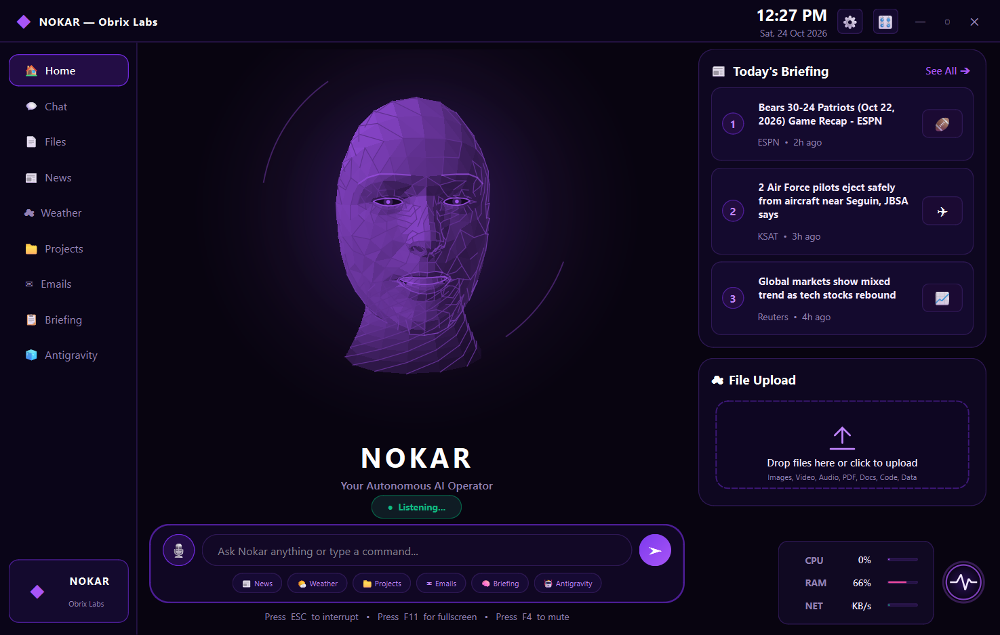
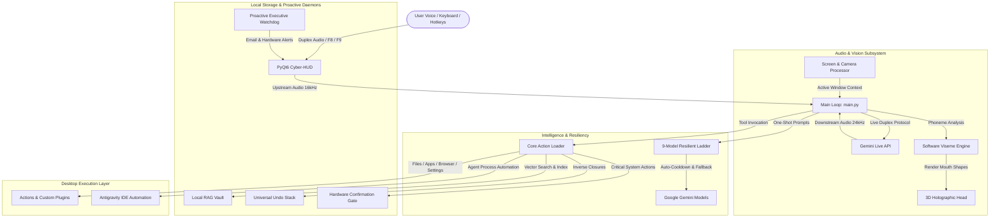

<div align="center">

# NOKAR – Fully Autonomous AI Desktop Assistant

### *The Best Open-Source AI Desktop Assistant for Intelligent Automation, Real-Time Duplex Voice, Multimodal Vision, and Agentic Productivity.*

[](https://creativecommons.org/licenses/by-nc/4.0/)
[](https://www.python.org/)
[](#supported-platforms)
[](https://riverbankcomputing.com/software/pyqt/)
[](https://ai.google.dev/)
[](https://obrixlabs.com)
[](https://github.com/anasraheemdev)

<br/>

[**Explore Features**](#key-features) •
[**Quick Start**](#installation-and-setup) •
[**Architecture**](#system-architecture) •
[**Documentation**](#documentation-index) •
[**FAQ**](#frequently-asked-questions) •
[**Maintainer**](#about-the-developer)

<br/>



</div>

---

## What Is NOKAR?

**NOKAR** is a production-ready, open-source, fully autonomous **AI desktop assistant** engineered to give you complete digital autonomy over your computer. Built on the **Google Gemini Live API** for native bidirectional audio streaming and powered by a modern **PyQt6 frosted-glass HUD**, NOKAR can hear, see, speak, reason, and operate your desktop environment in real time.

Unlike traditional text-based chatbots or rigid voice wrappers, NOKAR functions as a true **agentic desktop assistant**: it can actively inspect your foreground applications, manage files, search the web, execute complex multi-step workflows, monitor system telemetry, manage emails, control IDE processes, and remember your projects across sessions—all with zero subscription fees and complete local privacy.

---

## Why Choose NOKAR as Your AI Desktop Assistant?

| Capability | NOKAR Autonomous Assistant | Traditional Web Chatbots | Standard Voice Assistants |
|---|:---:|:---:|:---:|
| **Real-Time Duplex Audio** | **Native Gemini Live streaming** (no turn-taking lag) | ❌ Text only / Turn-based | ⚠️ High latency, cloud-locked |
| **Active Screen Vision** | **Real-time monitor & foreground context inspection** | ⚠️ Static manual file upload | ❌ No screen awareness |
| **Desktop Automation** | **Direct OS control** (apps, files, shell, settings) | ❌ Sandboxed in browser | ⚠️ Proprietary / locked ecosystem |
| **Model Resiliency** | **9-Model automatic failover ladder** with cooldowns | ❌ Single point of failure | ❌ Proprietary model locked |
| **Personal Document RAG** | **Local Vector Vault** (zero external database) | ❌ Cloud storage only | ❌ No codebase awareness |
| **Safety & Control** | **Hardware-level confirmation gate & Universal Undo** | ❌ No desktop rollback | ❌ No undo capabilities |
| **Proactive Watchdog** | **Background email, hardware & deadline monitoring** | ❌ Passive waiting for prompt | ⚠️ Simple fixed alarms |
| **Hardware Overhead** | **Software 3D rendering** (No GPU required) | N/A | High resource usage |
| **Privacy & Security** | **Local credentials & zero centralized telemetry** | ❌ Cloud telemetry tracking | ❌ Proprietary telemetry logging |

---

## Key Features

### 🎙️ Real-Time Voice Duplex & Lip-Sync
- **Gemini Live Streaming**: Ultra-low latency voice conversation powered by Gemini Live for continuous human-speed dialogue.
- **Push-to-Talk (`Ctrl+Space`)**: Seamless hardware-level microphone control on Windows, macOS, and Linux.
- **Formant-Based Lip-Sync**: ~50 facial mouth poses per second generated from audio formants and phoneme analysis.
- **Acoustic Echo Guard**: Dynamically isolates the assistant's audio output to prevent self-triggering feedback.

### 👁️ Screen Understanding & Multimodal Vision
- **Active Window Context Awareness**: Win32 foreground inspection automatically tags the active application window into Gemini's prompt context.
- **Instant Screen Capture (`F9`)**: Quick-action capture button and global hotkey allowing NOKAR to inspect your screen and answer questions about code, designs, or documents.

### ⧉ In-App Video Picture-in-Picture (PiP)
- **Floating Glass Card**: Dedicated 360×240 draggable overlay (`VideoPipWidget`) with mute, expand, and close controls.
- **Simultaneous Avatar Presentation**: Plays YouTube videos, local media, and HLS streams while keeping the 3D animated avatar active and visible.

### 🐕 Proactive Autonomous Watchdog (Executive Assistant)
- **Email Inbox Monitoring**: Background IMAP integration (Hostinger / custom email) alerts you to high-priority unread communications.
- **Hardware Telemetry Protection**: Continuously tracks CPU and RAM usage, alerting via voice and HUD when usage exceeds 90%.
- **Project Milestone Tracking**: Scans `memory/ongoing_projects.json` for impending task deadlines and delivers scheduled briefings.

### 🧠 Local Codebase & Personal Document RAG (Vector Vault)
- **Local Semantic Retrieval**: Built-in TF-IDF and cosine similarity engine indexing `.py`, `.js`, `.md`, `.txt`, `.pdf`, `.csv`, and configuration files.
- **Automatic Upload Indexing**: Dropping or attaching any file into the UI automatically ingests and vectors the content into `memory/rag_vault.json`.
- **Integrated Action**: Discoverable tool `query_rag_vault` allows the AI agent to search and cite exact snippets from your local files.

### 🔍 System-Wide Quick Summon (Spotlight Bar)
- **Global Hotkey (`F8` / `Alt+Space`)**: Summons a translucent frosted-glass command bar from any desktop screen.
- **Instant Dispatch**: Send quick voice or typed commands, trigger screen vision, check system stats, or dismiss with `Escape`.

### ⚡ Bidirectional Antigravity IDE Automation
- **Process Inspection & Control**: Launch, inspect, and verify the health of Antigravity IDE instances directly from the HUD.
- **Workspace Navigation**: Built-in folder browser and task prompt dispatcher for agentic coding workflows.

### 🪜 9-Model Resilient Fallback Ladder
- **Automatic Failover**: When a model hits rate quotas (429) or timeouts (503/504), requests automatically step down a 9-model ladder:
  `gemini-3.5-flash-lite` → `gemini-3.1-flash-lite` → `gemini-flash-lite-latest` → `gemini-2.5-flash` → `gemini-2.5-flash-lite` → `gemini-3.5-flash` → `gemini-3-flash-preview` → `gemini-3.6-flash` → `gemini-flash-latest`.
- **Intelligent Cooldowns**: Dead models rest for 30 minutes, quota limits rest for 5 minutes, preventing blocked API requests.

### 🛡️ Safety Gates & Universal Undo
- **Hardware Confirmation Gate**: Destructive actions (system shutdown, reboot, Wi-Fi disabling) require explicit user clicks on a physical HUD banner.
- **Universal Reversible Undo**: Say *"undo"* in any language to reverse the last file action (create, move, copy, rename, delete) or desktop setting change.

---

## System Architecture



---

## Supported Platforms

| Platform | Support Tier | Details |
|---|:---:|---|
| **Windows 10 / 11** | **Tier 1 (Full)** | Native Win32 foreground inspection, global push-to-talk (`Ctrl+Space`), hardware telemetry |
| **macOS (Sonoma / Sequoia)** | **Tier 1** | Windowed push-to-talk, desktop automation, sound routing |
| **Linux (Ubuntu / Debian / Fedora)**| **Tier 1** | X11/Wayland desktop automation, systemd integration |

---

## Technology Stack

| Category | Technologies |
|---|---|
| **Programming Language** | Python 3.11, 3.12, 3.13 |
| **Frontend & HUD** | PyQt6, QGraphicsView, QPropertyAnimation, Frosted Glass CSS |
| **AI & Multimodal Models** | Google Gemini Live API, Gemini 3.5 Flash, Gemini 2.5 Flash |
| **Audio & DSP** | PyAudio, SoundDevice, NumPy, Custom Formant Viseme Analyzer |
| **Vision & Video** | OpenCV (`cv2`), `yt-dlp`, Qt Multimedia |
| **Hardware Telemetry** | `psutil`, `pynvml` (NVIDIA GPU telemetry) |
| **Automation & Protocols** | Win32 API, Playwright, IMAP4 / SMTP, Subprocess IPC |

---

## Installation and Setup

### Prerequisites

- **Python**: Version 3.11, 3.12, or 3.13 installed ([python.org](https://www.python.org/downloads/)).
- **Git**: Installed on your system.
- **Hardware**: Working microphone and speakers / headphones.
- **Google Gemini API Key**: A free key from [Google AI Studio](https://aistudio.google.com/app/apikey).

### 1. Clone the Repository

```bash
git clone https://github.com/anasraheemdev/nokar-fully-autonomous-ai-assistant.git
cd nokar-fully-autonomous-ai-assistant
```

### 2. Create and Activate a Virtual Environment

```bash
# Windows (PowerShell)
python -m venv .venv
.\.venv\Scripts\Activate.ps1

# macOS / Linux
python3 -m venv .venv
source .venv/bin/activate
```

### 3. Install Dependencies

NOKAR includes an OS-aware installer that skips packages not relevant to your current operating system:

```bash
python setup.py
```

*Alternatively, install via pip:*
```bash
pip install -r requirements.txt
```

### 4. Configure Credentials

Copy the example configuration files and add your Gemini API key:

```bash
# Copy the environment template
cp .env.example .env

# Or copy the configuration JSON
cp config/api_keys.example.json config/api_keys.json
```

Open `config/api_keys.json` in your editor and enter your Gemini API key:
```json
{
  "gemini_api_key": "YOUR_GEMINI_API_KEY_HERE",
  "assistant_name": "Nokar",
  "user_name": "Commander",
  "default_city": "London",
  "voice_name": "Puck"
}
```

### 5. Launch NOKAR

```bash
python main.py
```

*Windows shortcut: You can also double-click `start_nokar.bat` to launch the assistant.*

---

## Real-World Use Cases

- **Autonomous Coding & Debugging**: Press `F9` while viewing a code error in your IDE. NOKAR captures the screen, notes the active IDE window, and immediately explains the solution via voice.
- **Executive Morning Briefing**: Boot your PC in the morning to receive a spoken summary of the local weather, top technology headlines, unread high-priority emails, and pending project milestones.
- **Hands-Free Desktop Control**: Say *"Open Chrome and search for quantum computing papers"*, *"Turn down the volume by 20%"*, or *"Organize my desktop"* while working on other tasks.
- **Codebase & Document Research**: Drop a 50-page PDF report or project folder into the HUD. Ask *"What are the key findings in section 3?"* and NOKAR instantly retrieves citations from the local RAG Vault.
- **Video Learning in Picture-in-Picture**: Say *"Play the new Python tutorial"*. The video begins playing in a compact, floating PiP card while the 3D avatar remains active to answer questions.

---

## Documentation Index

- [docs/ARCHITECTURE.md](docs/ARCHITECTURE.md): Detailed internal architecture, Gemini Live streaming protocol, Model Ladder logic.
- [docs/CONFIGURATION.md](docs/CONFIGURATION.md): Comprehensive configuration settings, environment variables, audio device routing.
- [docs/TOOLS.md](docs/TOOLS.md): Complete catalog of all 16+ bundled tools, actions, and plugin development guide.
- [CONTRIBUTING.md](CONTRIBUTING.md): Contributing guidelines, development setup, code standards, and PR process.
- [CODE_OF_CONDUCT.md](CODE_OF_CONDUCT.md): Contributor Covenant v2.1 code of conduct.
- [SECURITY.md](SECURITY.md): Security policy, vulnerability reporting SLA, and local privacy guarantees.
- [CHANGELOG.md](CHANGELOG.md): Complete chronological release history.
- [SUPPORT.md](SUPPORT.md): Support channels, issue tracking, and enterprise contact.

---

## Frequently Asked Questions

#### Q: Is NOKAR completely open source?
**A:** Yes. NOKAR is released under the **Creative Commons Attribution-NonCommercial 4.0 International License (CC BY-NC 4.0)** for personal, educational, and research use. Commercial licensing is available through Obrix Labs.

#### Q: Does NOKAR require an expensive dedicated GPU?
**A:** **No.** Unlike heavy local LLM wrappers, NOKAR leverages Google's ultra-fast Gemini Live streaming cloud models. The 3D holographic avatar is rendered in pure software geometry using PyQt6 and NumPy, consuming minimal CPU and zero dedicated VRAM.

#### Q: How does NOKAR protect my personal data and privacy?
**A:** NOKAR stores all API keys, email credentials, long-term memory, and RAG document indexes locally on your computer in git-ignored files. There are no centralized telemetry backends, tracking scripts, or analytics servers. Audio is only streamed to Google's official Gemini endpoint during active voice interactions.

#### Q: Can NOKAR perform destructive system actions without asking?
**A:** **No.** Destructive actions such as system shutdown, restarting, or disabling Wi-Fi pass through our Hardware Confirmation Gate, which generates an unforgeable UI banner that only executes when physically clicked by the user.

#### Q: How do I create a custom skill or plugin?
**A:** Simply copy `plugins/_template.py`, define a `TOOL` dictionary and a `handle(params)` function, and save it in the `plugins/` directory. NOKAR automatically discovers and registers your new skill at launch.

---

## Roadmap

- [x] **v1.0.0**: Gemini Live streaming, 3D software avatar, 9-model ladder, Screen Vision, In-App Video PiP, Local RAG Vault, Spotlight Bar, Proactive Watchdog.
- [ ] **v1.1.0**: Native speech interruption handling & real-time audio ducking.
- [ ] **v1.2.0**: Multi-monitor screen selection and regional visual OCR.
- [ ] **v1.3.0**: Obsidian vault bi-directional note synchronization.
- [ ] **v2.0.0**: Distributed local agent mesh for multi-device desktop control.

---

## Contributing

We welcome contributions from developers worldwide! Please review [CONTRIBUTING.md](CONTRIBUTING.md) and our [Code of Conduct](CODE_OF_CONDUCT.md) before submitting pull requests.

```bash
# Run the verification suite before opening a PR
python tests/test_ui_features.py
```

---

## License & Third-Party Notices

- **License**: Licensed under [Creative Commons Attribution-NonCommercial 4.0 International (CC BY-NC 4.0)](LICENSE).
- **Copyright**: © 2026 **Muhammad Anas Raheem** (Obrix Labs).
- **Third-Party Assets**:
  - `core/face_model.obj`: Derived from the [MediaPipe](https://github.com/google-ai-edge/mediapipe) canonical 3D face model, Copyright © Google LLC, licensed under the **Apache License 2.0**.

---

## About the Developer

<table align="center">
  <tr>
    <td align="center" width="140">
      
    </td>
    <td>
      <h3>Muhammad Anas Raheem</h3>
      <p><b>AI Engineer | Full-Stack Developer | Founder, Obrix Labs</b></p>
      <p>
        <a href="https://github.com/anasraheemdev"></a>
        <a href="https://www.linkedin.com/in/anasraheem/"></a>
        <a href="https://obrixlabs.com"></a>
        <a href="mailto:info@obrixlabs.com"></a>
        <a href="https://wa.me/923462440356"></a>
      </p>
    </td>
  </tr>
</table>

---

<div align="center">
  <sub>Engineered with passion by <b>Muhammad Anas Raheem</b> at <b>Obrix Labs</b>. ⭐ Star this repository to support future autonomous AI releases!</sub>
</div>
