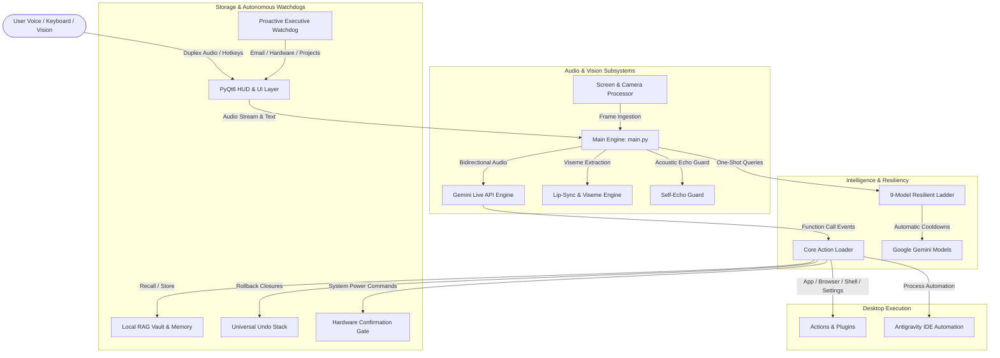

# NOKAR System Architecture

This document provides a comprehensive technical overview of **NOKAR – Fully Autonomous AI Desktop Assistant**, detailing its internal components, data flows, communication protocols, and execution lifecycle.

---

## Architecture Overview

NOKAR couples a native graphical HUD (PyQt6) with a real-time duplex audio engine (Gemini Live API) and an autonomous action execution engine.

---

## 1. Core Engine (`main.py`)

The core execution loop coordinates:
- **Duplex Audio Streaming**: Streams 16 kHz PCM audio upstream to the Google Gemini Live endpoint while receiving 24 kHz raw PCM audio downstream.
- **Microphone Management & Push-to-Talk**: Global push-to-talk (`Ctrl+Space`) and local hotkey triggers.
- **Viseme & Lip-Sync Synchronization**: Audio output is analyzed via formants and phoneme mapping to synchronize ~50 facial mouth poses per second.
- **Echo Suppression (`core/echo.py`)**: Distinguishes the user's voice from the assistant's own acoustic output to prevent self-triggering loops.

---

## 2. Model Ladder & Resiliency (`core/gemini.py`)

All one-shot non-streaming Gemini requests (summarization, tool parameter parsing, background queries) route through a centralized 9-model ladder:

| Priority | Model Identifier | Timeout | Cooldown Period | Trigger Condition |
|:---:|---|:---:|:---:|---|
| **1** | `gemini-3.5-flash-lite` | 10s | 5 min / 30 min | Primary default |
| **2** | `gemini-3.1-flash-lite` | 10s | 5 min / 30 min | Failover 1 |
| **3** | `gemini-flash-lite-latest` | 10s | 5 min / 30 min | Failover 2 |
| **4** | `gemini-2.5-flash` | 10s | 5 min / 30 min | Failover 3 |
| **5** | `gemini-2.5-flash-lite` | 10s | 5 min / 30 min | Failover 4 |
| **6** | `gemini-3.5-flash` | 12s | 5 min / 30 min | Failover 5 |
| **7** | `gemini-3-flash-preview` | 15s | 30 min | Deep fallback |
| **8** | `gemini-3.6-flash` | 15s | 30 min | Deep fallback |
| **9** | `gemini-flash-latest` | 15s | 30 min | Emergency fallback |

### Error Cooldown Logic
- **HTTP 429 (Quota Exhausted)**: Model rested for 5 minutes (refill cycle).
- **HTTP 503 / 504 / Deadline Exceeded**: Model rested for 30 minutes.
- **HTTP 404 (Access / Key Denied)**: Model rested for 6 hours.

---

## 3. Local Vector & Document RAG Vault (`core/rag_vault.py`)

- **Document Ingestion**: Parses `.py`, `.js`, `.ts`, `.md`, `.txt`, `.json`, `.pdf`, `.csv`, as well as standard configuration files (`LICENSE`, `DOCKERFILE`, `MAKEFILE`).
- **Chunking Pipeline**: Sliding-window token chunking with overlap to preserve structural context.
- **Similarity Scoring**: Term-frequency inverse-document frequency (TF-IDF) and cosine similarity matrix matching.
- **Persistence**: Cached locally in `memory/rag_vault.json`.

---

## 4. Proactive Executive Watchdog (`core/proactive_watchdog.py`)

Runs as an independent background daemon thread with three primary monitoring vectors:
1. **Email Integration**: Periodically polls Hostinger / IMAP inboxes for high-priority unread emails.
2. **System Telemetry**: Alerts when CPU or RAM utilization crosses 90%.
3. **Project Deadlines**: Cross-references deadlines from `memory/ongoing_projects.json` to deliver timely voice and HUD notifications.

---

## 5. Security Gates & Universal Undo

- **Irreversible Confirmation Gate (`core/confirm.py`)**:
  Destructive system actions (`shutdown`, `restart`, `toggle_wifi`) emit an unforgeable UI token. The action only executes when the user physically clicks the confirmation banner.
- **Universal Undo Stack (`core/undo.py`)**:
  File operations (creation, copy, move, rename, deletion) and system setting adjustments register atomic inverse closures on an in-memory stack, allowing instant voice rollback via `"undo"`.
